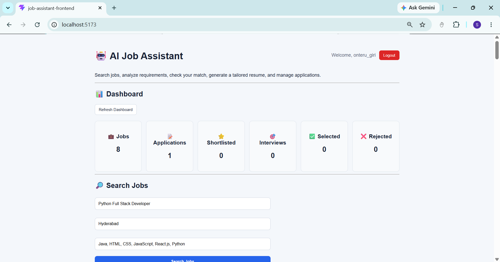
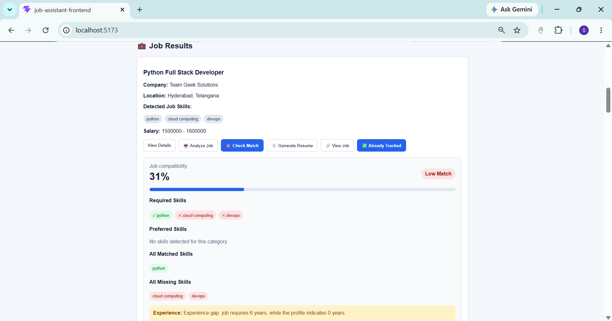

# AI Job Assistant — Frontend

A React web app built with Vite for the AI Job Assistant. It connects to the Spring Boot backend so users can search jobs, compare job skills with their profile, generate AI analysis and resume suggestions, and manage tracked applications.

## Requirements

- Node.js and npm
- The AI Job Assistant backend running at `http://localhost:8080`

## Install dependencies

Open PowerShell in the frontend project folder—the folder containing `package.json`—and run:

```powershell
npm install
```

## Start the development server

```powershell
npm run dev
```

Open the local URL printed in the terminal. It is usually:

```text
http://localhost:5173
```

Keep the terminal window open while using the frontend.

## Run the backend

Start the Spring Boot backend before using frontend features that need the API, such as login, profile loading, job search, and application tracking.

The backend API normally runs at:

```text
http://localhost:8080
```

See the backend project's `README.md` for MySQL, Ollama, and API credential setup.

## Build for production

```powershell
npm run build
```

Vite creates the production files in the `dist/` folder.

## Preview the production build

After building, run:

```powershell
npm run preview
```

Open the local URL printed in the terminal.

## Main features

- User registration and login
- Job search and results
- Job match scores and skill gaps
- AI job analysis
- Tailored resume suggestions
- Application tracking and status management

## Screenshots

### Dashboard



### Job match and skill gaps



## Security

- Do not put passwords, API keys, or other secrets in frontend source files.
- Do not commit `.env` files or local credentials.
- The frontend `.gitignore` excludes `node_modules/`, build output, and local environment files.

## License

Add a license before redistributing this project.